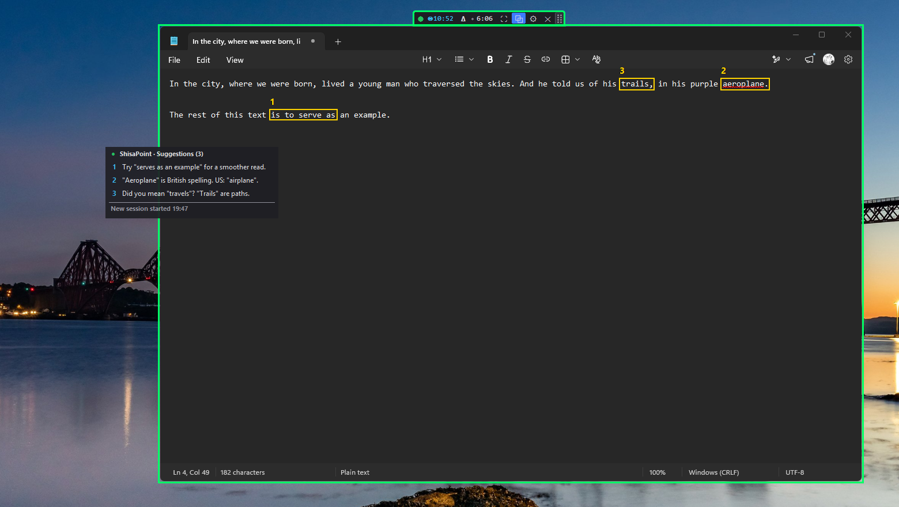
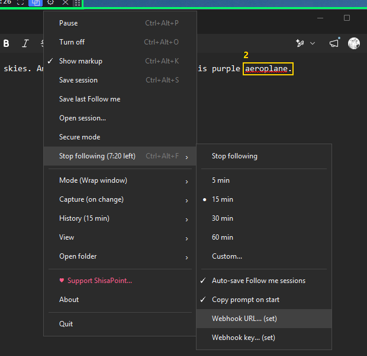
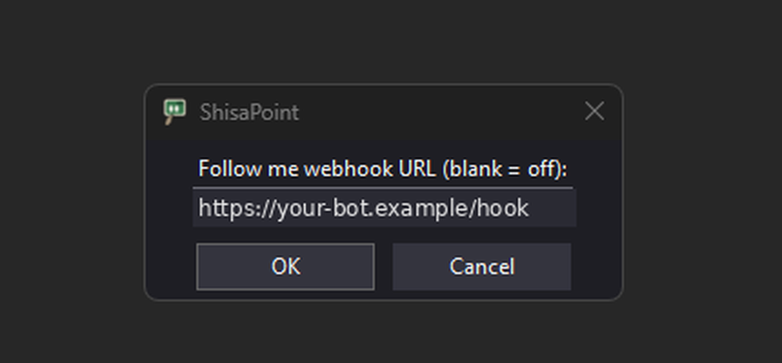

# ShisaPoint

ShisaPoint is a free Windows app that puts a see-through frame on your screen so your AI assistant can follow along.



## What it does

- **The frame.** A see-through, always-on-top frame you can move and resize. When it is locked, clicks pass through it. You can capture a region, a whole monitor, or a window you pick.
- **Snapshots.** The app saves a snapshot of what is inside the frame. By default it snaps when the screen changes (after a short settle), or you can set a fixed interval (5 seconds by default). Files go in `%USERPROFILE%\ShisaPoint\snapshots` as `latest.jpg`, `lens_*.jpg`, and `meta.json`. Older frames are trimmed after 15 minutes by default, with a 100 MB cap.
- **OCR.** Each snapshot is read locally with Windows OCR. The text is written to `latest.txt` and into `meta.json`.
- **Suggestion panel.** Your assistant writes `suggestions.json`, and notes show up in a panel (Ctrl+Alt+G). You can drag the panel, and it can keep the last few suggestions.
- **Markup boxes.** Your assistant can draw numbered boxes, arrows, and other marks from `markup.json`. A suggestion can also name a phrase on screen, and the app will box that phrase and keep the box with the text as it moves.
- **Follow me.** Press Ctrl+Alt+F (or use the menu) to start a timed session. The default is 15 minutes, with a countdown on the tab. Press the hotkey again, or click the countdown, to stop. While a session is running, capture stays on-change.
- **Secure mode.** Optional. Snapshots, OCR text, history, and saved sessions are encrypted to your Windows account. History is wiped when you quit (saved sessions stay, still encrypted, unless you turn on wiping those too).
- **Privacy pause.** Capture pauses on its own while a password manager or banking window is in front (matched by the window title). Press Ctrl+Alt+P anytime to pause yourself.

Default hotkeys (all rebindable in View > Keyboard shortcuts):

| Key | Action |
|---|---|
| Ctrl+Alt+F | Start or stop Follow me |
| Ctrl+Alt+P | Pause or resume capture |
| Ctrl+Alt+L | Edit or lock the frame (region mode) |
| Ctrl+Alt+G | Show or hide the suggestion panel |
| Ctrl+Alt+S | Save the current history as a session zip |
| Ctrl+Alt+Q | Quit |

The tray icon and the gear on the tab open the same menu: mode, capture interval, history, theme, Secure mode, and more. Under View, **Show in screenshots** is off by default, so the frame, suggestion panel, and other ShisaPoint windows stay hidden from Snipping Tool, recordings, and similar capture. Turn it on if you want them to appear in a demo. The app's own snapshots still leave that chrome out of the grab.

## Privacy

ShisaPoint does not upload your screen to a ShisaPoint server. Snapshots and OCR stay in the folder on your PC. History is trimmed as described above.

By default, ShisaPoint windows are also hidden from other apps' screen capture. You can change that with View > Show in screenshots (`show_in_screenshots` in `config.json`, default off).

The only network call the app makes is the Follow me webhook that you set. A start or stop event is a small JSON POST. It does not include a screenshot. It does include the event name, session length, the snapshot folder path, the path to `meta.json`, and the time. If you turn on webhook-on-confirm (off by default), each confirmed snapshot also posts a short OCR text excerpt (the last 500 characters). Secure mode drops that excerpt, and it also keeps screen text and window titles out of the plain `meta.json` and the clipboard prompt.

Your assistant then reads the local files. What it does with them after that is up to that assistant.

Secure mode uses Windows DPAPI, tied to your Windows account on this PC. `suggestions.json` and `markup.json` stay as plain files so your assistant can write them. You can turn Secure mode on from the menu. Turning it on wipes the existing unencrypted history first.

## Install

Download the exe from the Releases page: [download link]

It runs on Windows 10 and 11. Put `ShisaPoint.exe` in a folder of its own. On first run it writes `config.json` next to the exe, and it saves snapshots under `%USERPROFILE%\ShisaPoint\snapshots`. The log is `%USERPROFILE%\ShisaPoint\shisapoint.log`.

Windows SmartScreen may warn that the app is unrecognized, because the exe is not code-signed yet. If you trust the download, choose More info, then Run anyway.

## Connecting your AI assistant

You need an assistant that can read files on your PC and receive a webhook (for example Grok Bot). Without one, ShisaPoint still works as a timed region snapshot tool.

1. In the app, open Follow me, then Webhook URL, and paste the webhook your assistant gives you. Leave it blank to turn the webhook off.
2. Optionally set Follow me, Webhook key. If set, it is sent as `Authorization: Bearer <key>`.





3. Start a Follow me session (Ctrl+Alt+F). The app POSTs a `follow_start` event to your webhook, takes a baseline snapshot, and (by default) copies a short prompt to the clipboard. When the session ends, it POSTs `follow_stop` with the reason, unless you turn that off.

The start payload looks like this:

```json
{
  "event": "follow_start",
  "limit_min": 15,
  "expires": "2026-11-09T18:45:00-07:00",
  "output_dir": "C:\\Users\\YourName\\ShisaPoint\\snapshots",
  "meta_path": "C:\\Users\\YourName\\ShisaPoint\\snapshots\\meta.json",
  "time": "2026-11-09T18:30:00-07:00",
  "secure": false
}
```

Your assistant should read `latest.jpg` (or `latest.png`) and `meta.json` in that folder. In Secure mode, use `read_snapshot.ps1` (or `follow.ps1`, which decrypts on its own). To show a note, write `suggestions.json`. To draw boxes, write `markup.json`. `write_suggestions.ps1` writes the suggestions file safely.

`follow.ps1` can poll for the next confirmed snapshot and print only the new OCR lines.

## Config options

Most of these are also in the tray and gear menus. Settings live in `config.json` next to the exe. Here is a sample with generic values:

```json
{
  "mode": "region",
  "interval_seconds": 5,
  "capture_mode": "on_change",
  "output_dir": "%USERPROFILE%\\ShisaPoint\\snapshots",
  "x": 200,
  "y": 200,
  "width": 640,
  "height": 400,
  "monitor_index": 1,
  "window_title": "",
  "ocr_enabled": true,
  "suggestions_enabled": true,
  "retention_minutes": 15,
  "max_cache_mb": 100,
  "follow_limit_min": 15,
  "follow_webhook_url": "https://example.com/your-webhook",
  "follow_webhook_key": "your-key-here",
  "follow_webhook_on_stop": true,
  "follow_webhook_on_confirm": false,
  "follow_copy_prompt": true,
  "follow_autosave": false,
  "secure_mode": false,
  "secure_wipe_on_quit": true,
  "secure_wipe_sessions": false,
  "privacy_pause_enabled": true,
  "privacy_pause_titles": [
    "1Password",
    "Bitwarden",
    "KeePass",
    "LastPass",
    "Bank",
    "Credential Manager"
  ],
  "theme": "system",
  "show_in_screenshots": false,
  "hotkeys": {
    "edit": "Ctrl+Alt+L",
    "pause": "Ctrl+Alt+P",
    "quit": "Ctrl+Alt+Q",
    "follow": "Ctrl+Alt+F",
    "panel": "Ctrl+Alt+G",
    "save": "Ctrl+Alt+S"
  }
}
```

`capture_mode` is `on_change` (snap when the screen changes) or `interval` (every `interval_seconds`). In on-change mode you can still set a maximum gap so a snapshot happens anyway. `mode` is `region`, `monitor`, or `window`. Environment variables in `output_dir` are expanded.

## Building from source

You need Windows and Python 3.11 (that is what `build_exe.bat` and the GitHub Actions workflow use).

```
pip install -r requirements.txt
py -3.11 desktop_lens.py
```

Or double-click `run.bat`, which creates a venv on the first run.

To build a single exe:

```
build_exe.bat
```

The shipped build uses the spec file, which also bundles the certifi CA list:

```
py -3.11 -m pip install -r requirements.txt pyinstaller
py -3.11 -m PyInstaller --noconfirm --clean ShisaPoint.spec
```

Put `config.json` next to `dist\ShisaPoint.exe` if you want your settings to travel with it. Helper scripts (`follow.ps1`, `read_snapshot.ps1`, `write_suggestions.ps1`, `close_app.ps1`) should sit beside the exe as well.

## Support

Questions, bugs, or suggestions: [support@shisapoint.com](mailto:support@shisapoint.com)

## Tip jar

ShisaPoint is free. Tips are optional and go toward keeping it going: [ko-fi.com/shisapoint](https://ko-fi.com/shisapoint)

## License

[MIT](LICENSE). Copyright (c) 2026 Ryan Thompson.
